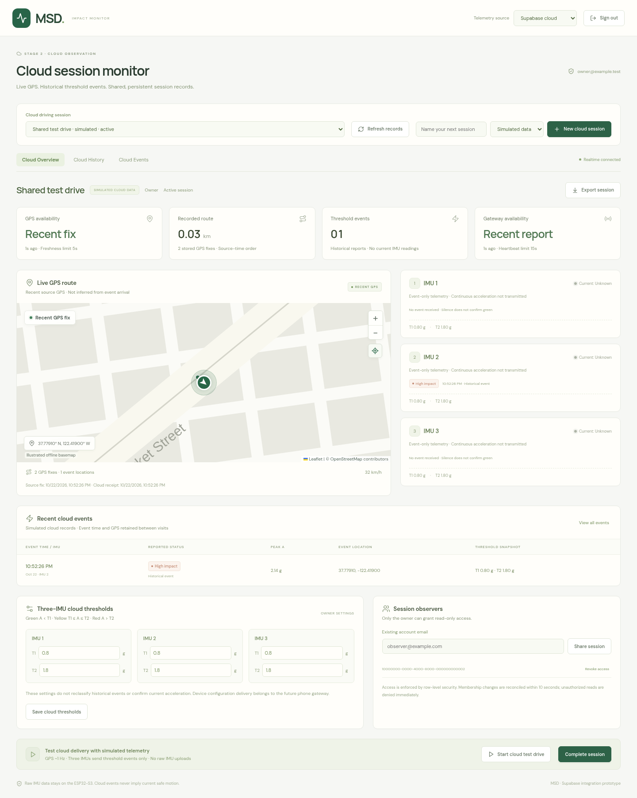
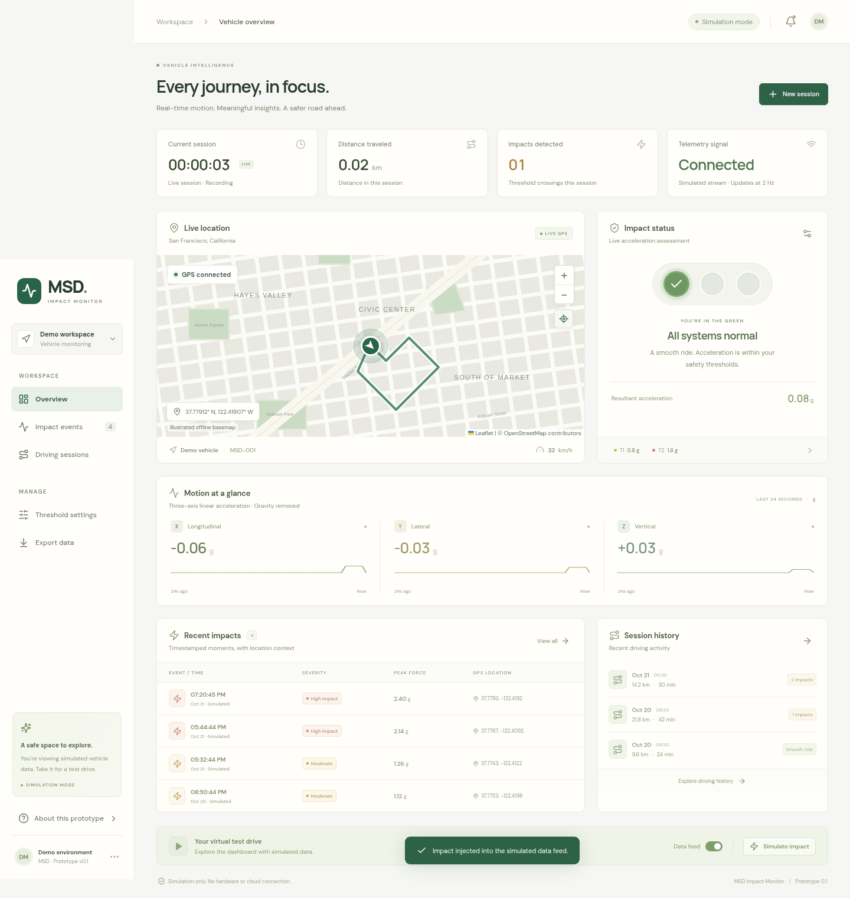
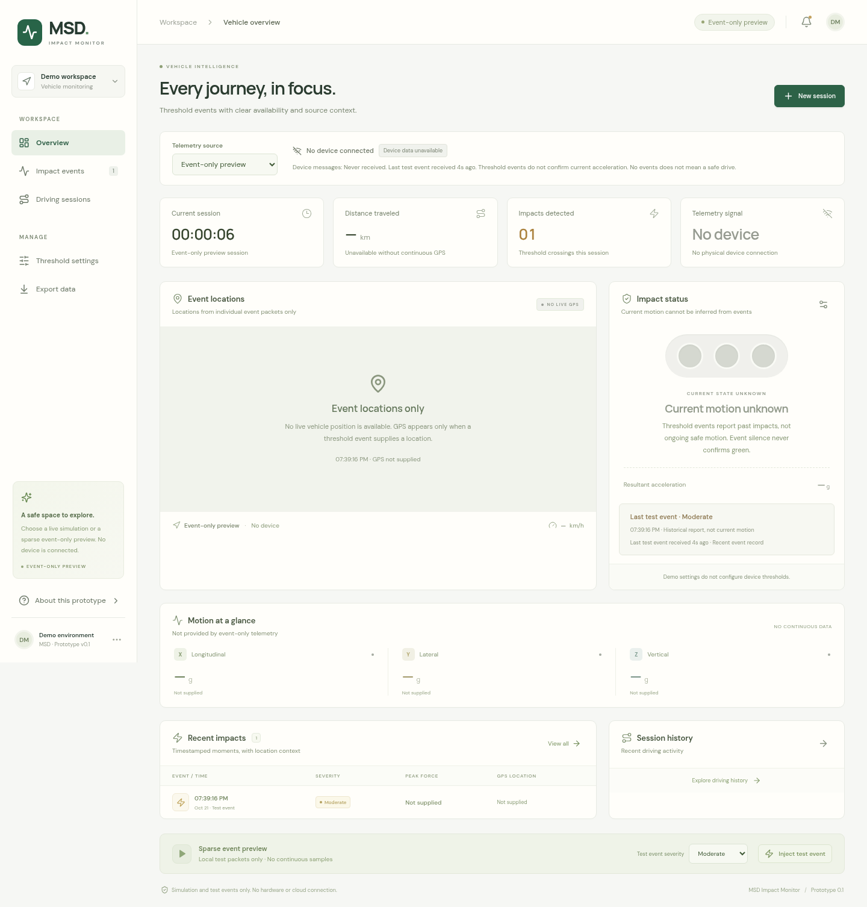

# MSD Impact Monitor

A React + TypeScript observer dashboard for vehicle GPS and threshold events. Stage 2 adds authenticated Supabase storage, shared real-time observation, three-IMU threshold configuration, and persistent cloud session history. The local demonstrations still run without Supabase configuration.



The cloud preview uses simulated test records. Configure your own Supabase project using the steps below to connect a hosted database.

## Run locally

Use **Node.js 22.12+** (Node 24 recommended) and npm:

```sh
npm ci
npm run dev
```

Open the address Vite prints, normally `http://localhost:5173`. To preview the production bundle:

```sh
npm run build
npm run preview
```

The preview address is normally `http://localhost:4173`. Vite's development and preview servers bind to all interfaces for development-container use; they are not a production deployment.

## Choose a telemetry source

Use **Telemetry source** to switch between:

| Source                 | What it displays                                                                                                                         | Persistence                                                       |
| ---------------------- | ---------------------------------------------------------------------------------------------------------------------------------------- | ----------------------------------------------------------------- |
| **Live simulation**    | Moving demo vehicle, signed X/Y/Z acceleration axes, automatic/injected impacts, adjustable local thresholds                             | In memory; resets on refresh                                      |
| **Event-only preview** | Sparse local test events; no device connection or fabricated continuous values                                                           | In memory; resets on refresh                                      |
| **Supabase cloud**     | Authenticated cloud sessions, live geographic GPS route, event locations, connection freshness, and threshold-event history for IMUs 1–3 | Database; survives visits and is shared with authorized observers |

Cloud mode never falls back to demo values while claiming to show a real device. Sessions carry immutable **simulated** or **device** provenance. The optional cloud test drive uploads simulated GPS/events through the normal authenticated database path only into simulated sessions. No phone application, ESP32-S3 firmware, or physical sensor connection is included.

## Enable Supabase cloud

Follow the complete [Supabase setup guide](docs/SUPABASE_SETUP.md). The required steps are:

1. Create a Supabase project and apply [`supabase/migrations/20261021000100_msd_cloud.sql`](supabase/migrations/20261021000100_msd_cloud.sql) in its SQL Editor, or use an initialized/linked Supabase CLI and `supabase db push`.
2. Enable email/password Auth, configure the frontend Site URL and allowed redirect URLs, and confirm user emails.
3. Copy `.env.example` to `.env.local`, set `VITE_SUPABASE_URL` and `VITE_SUPABASE_PUBLISHABLE_KEY` to your project's **public** values, then restart Vite. A legacy public anon key is also supported.
4. Select **Supabase cloud**, sign in, create a simulated cloud session, and start its cloud test drive. Observe from a second browser, or share the session with another registered, email-confirmed user's email.

No credentials are needed to build or run the tests. All `VITE_` values are public in browser bundles. **Never put a Supabase service-role/secret key, database password, or administrative access token in frontend configuration.** The public key plus the signed-in user's JWT and database RLS determine access.

Owners control session creation, uploads, threshold settings, completion, and sharing. Explicitly shared observers can only read. Unrelated and anonymous users cannot access session data. Realtime reconnect refreshes and periodic reconciliation recover missed changes and recheck access.

## Availability and impact semantics

For known resultant acceleration `A = sqrt(x² + y² + z²)`, the rule is **green A < T1; yellow T1 ≤ A ≤ T2; red A > T2**. Both exact thresholds are yellow. Thresholds satisfy `0 < T1 < T2 ≤ 10 g`; default values are 0.8 g and 1.8 g. They are demonstration defaults, not calibrated safety limits.

**Gray means unavailable, stale, or unknown.** In event-only/cloud mode, a threshold event describes a past impact, not continuous current acceleration. No events, fresh GPS, or a healthy gateway heartbeat do not establish a green IMU state. Cloud IMU cards show the latest reported event separately from unknown current motion, and never invent continuous X/Y/Z readings. Complete raw IMU data is intended to stay on the ESP32-S3.

Cloud GPS freshness uses its source `recorded_at` time with a five-second limit; an old packet uploaded now is still historical. Gateway heartbeat freshness has a fifteen-second limit. The live map shows observed route coordinates and supplied event locations; stale GPS does not claim a live vehicle. Optional peak magnitude/GPS values remain `null` and display as **Not supplied**. Connection status to Supabase is separate from gateway status.

Cloud GPS/events are immutable and use stable packet UUIDs and sequence numbers. Duplicate/conflicting identities are first-write wins. Delayed/out-of-order points are sorted by source time without moving the live marker backward; packets recorded within a finished session's original time bounds can still arrive later. See [Telemetry protocol](docs/TELEMETRY_PROTOCOL.md) for fields, RPC examples, clock bounds, retry rules, and future phone-gateway responsibilities.

## Try the local demonstrations

- **Live GPS and axes:** the local vehicle follows a San Francisco route at 32 km/h. Its three displayed axes are simulated linear acceleration with gravity removed, not ESP32-S3 telemetry.
- **Impact controls:** select **Simulate impact** to inject a pulse. Automatic warning/critical pulses also alternate at thirty-second intervals. One continuous excursion becomes one peak event.
- **Threshold settings:** local demo settings affect only the live demonstration. Cloud per-IMU settings persist separately and do not reclassify recorded events or prove firmware delivery.
- **Freshness controls:** **Pause updates** demonstrates a connected but stale local stream; **Data feed** disconnects immediately. Missing/stale current readings and GPS are hidden and the status becomes gray. Reconnect waits for new samples.
- **Event-only preview:** **Inject test event** creates a labeled sparse local packet. It never establishes a real device connection or infers green from silence.
- **History/export:** local mode histories stay separate and reset on refresh. Export JSON before refreshing to retain them. Cloud sessions and events reload from Supabase between visits.





## Map behavior

Leaflet uses public OpenStreetMap raster tiles with attribution. Fonts and application assets are bundled locally. When tiles are blocked or unavailable, an illustrated offline basemap still supports geographically placed route/vehicle/event data; it is approximate and is not a navigation map. Local event-only preview does not invent a live route. OpenStreetMap's [tile usage policy](https://operations.osmfoundation.org/policies/tiles/) applies; choose a suitable tile provider before production deployment.

## Validate

```sh
npm run build        # TypeScript checks and optimized Vite build
npm test             # Domain, adapters, repository, and actual SQL/RLS migration tests
npm run test:e2e     # Local and cloud browser workflows with controlled fixtures
npm run format:check
```

Browser tests use `/usr/bin/chromium` when available. Otherwise install Playwright's browser once with `npx playwright install chromium`; on Linux, `npx playwright install --with-deps chromium` can also install required libraries. The browser runner starts its own isolated server and blocks external map tiles to exercise the fallback. GitHub Actions runs build, unit/database, and browser checks.

SQL tests execute the real migration in PostgreSQL via PGlite with **test-only** auth fixtures and roles. Cloud service/browser tests simulate Supabase HTTP and Realtime. They need no hosted-project credentials and do not claim to validate your project's email delivery, deployment, or network configuration. After configuring your own project, complete the [two-observer acceptance checklist](docs/SUPABASE_SETUP.md#4-test-two-observers-with-simulated-cloud-telemetry).

## Project structure

```text
src/
  components/            Local/cloud dashboards, geographic map, auth, event/session views
  domain/                Shared records, classification, freshness, deduplication, SQL tests
  hooks/                 Local monitor, cloud auth, scoped/reconnecting cloud session state
  services/
    telemetry.ts         Local continuous simulator and sparse event-only adapter
    supabase.ts          Public environment validation and lazy authenticated client
    cloudRepository.ts   Paginated reads, authenticated RPCs, and Realtime subscriptions
    cloudSimulator.ts    Owner-controlled simulated cloud GPS/events/heartbeat publisher
supabase/migrations/     Versioned schema, constraints, RPCs, RLS, and Realtime publication
 tests/                  Browser behavior, including credential-free cloud fixtures
 docs/                   Supabase setup and future telemetry protocol
```

The cloud observer integration is implemented here; driver phone software, microcontroller firmware, raw-IMU cloud streaming, and production deployment are future work.

## Stage 3 phone gateway

The iOS/Android React Native + TypeScript gateway is in [`mobile/`](mobile/README.md). It includes explicitly simulated BLE, a configurable hardware BLE adapter, phone GPS, authenticated Supabase uploads and a durable SQLite outbox. Apply the additive GPS accuracy migration before testing uploads. Physical Bluetooth, native builds and background execution still require Android/iPhone acceptance testing; no ESP32 firmware is included. See the mobile README for setup and the full test matrix.
