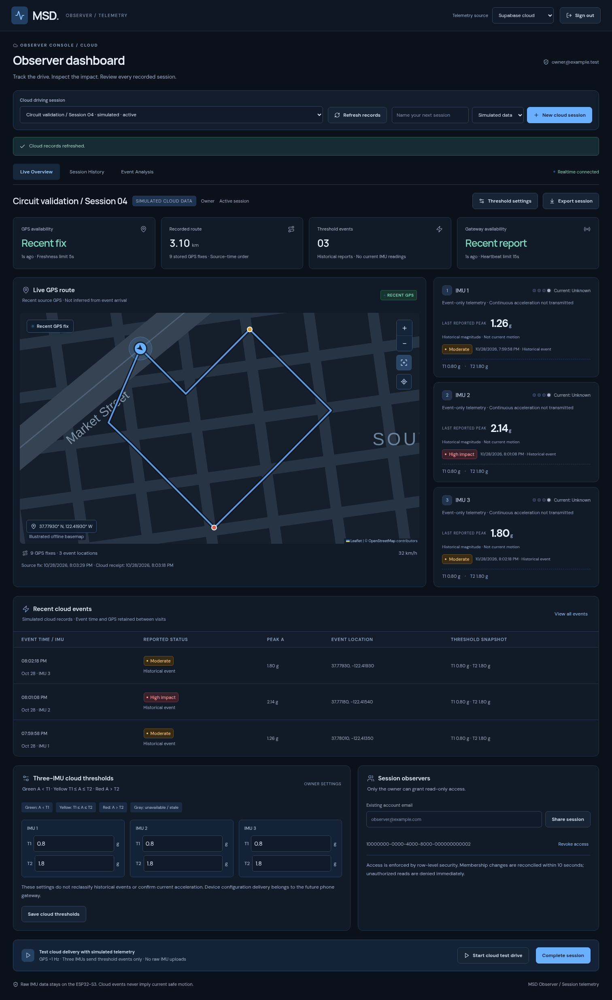
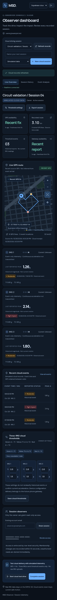
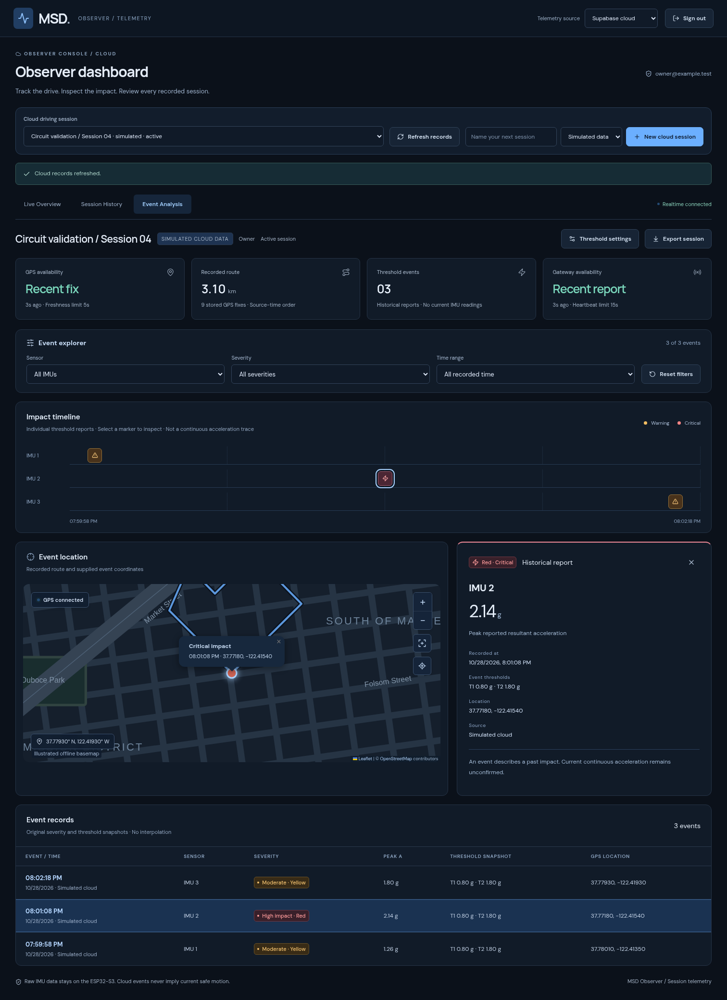
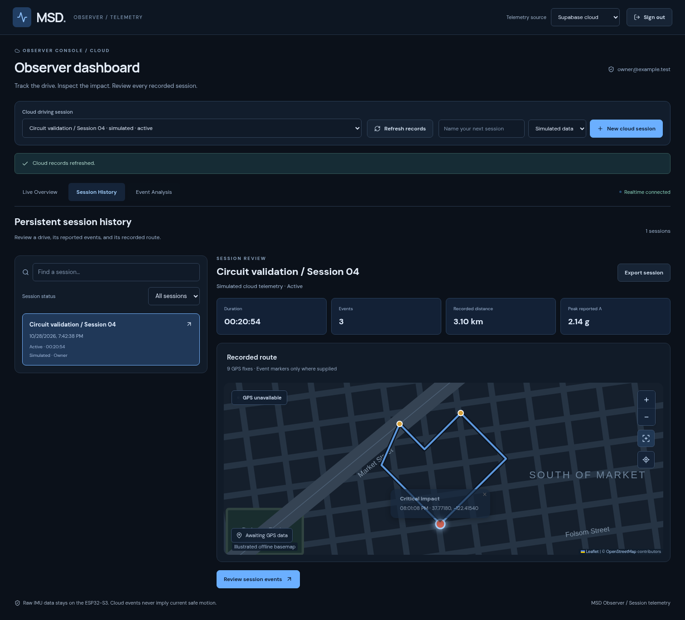

# Observer dashboard redesign — PR #4

This is a dashboard UI/UX change from the PR #3 merge on `main`. The Supabase schema, RPCs, authentication lifecycle, session subscription/permission logic, mobile gateway and firmware are unchanged. No hosted production dashboard was replaced.

## Interface and behavior

- Dark slate surfaces, readable typography, blue navigation/selection accents, amber warning and red critical reports. Severity uses text and symbols as well as color. Reduced-motion preferences, visible focus, keyboard-selectable timeline/map markers and touch controls are supported.
- The GPS map is the primary visual instrument. It displays supplied vehicle positions, captured routes and event markers. **Fit recorded route** reviews the route; **Follow vehicle** resumes live following. Stale/unavailable GPS never becomes a live marker, while recorded routes and events remain reviewable. Browser offline status removes current GPS confirmation immediately.
- Three cloud IMU cards keep **Current: Unknown** and a gray current indicator independently of the latest historical event's severity. Each card shows the last reported peak (or an explicit missing value), source timestamp and threshold settings. The local simulator is an aggregate source, not three per-IMU streams: its three IMU availability cards remain unavailable rather than assigning axes or events to invented sensors.
- Threshold controls explain **green A < T1; yellow T1 ≤ A ≤ T2; red A > T2; gray unavailable/stale**. Both boundaries stay yellow. Event snapshots are not reclassified by later settings changes. Saving cloud settings does not acknowledge application on hardware.
- Event analysis filters by sensor, reported severity, rolling time or an inclusive custom local-time range. The timeline shows separate reports, with no line connecting them or synthetic continuous acceleration chart. Timeline, table and supplied map markers select the same original event. Missing GPS cannot be highlighted, missing peaks remain missing, and absent sensor/threshold fields in legacy local events are not manufactured.
- Session history searches owned/shared sessions by name and filters active/completed status. Selecting a session uses the existing permission-checked snapshot path. The review shows duration, event count, peak reported magnitude, recorded distance, route and event markers, with existing JSON export. Missing reported peaks display **Not supplied**, not zero. It does not prefetch every session's telemetry.
- Local sessions retain positions actually captured during the browser visit, including completed sessions, and export them with session data. Older seeded demo sessions have no stored GPS route; review says so rather than drawing the planned demonstration loop as traveled. Continuous axis charts remain explicitly simulation-only.

## Screenshots

These screenshots use **simulated browser fixtures**, never real driver records. The source is labeled on screen. External map tiles were blocked to demonstrate the geographic route/markers over the labeled illustrated fallback. The fallback is approximate and is not a navigation map.

| Live overview, desktop                                                                                          | Live overview, mobile                                                               |
| --------------------------------------------------------------------------------------------------------------- | ----------------------------------------------------------------------------------- |
|  |  |





[Mobile event analysis screenshot](pr4/event-analysis-mobile.png) · [Local simulation](pr4/local-simulation.png) · [Event-only preview](pr4/event-only.png)

## Interactive review

[Download the self-contained simulation-only demo](pr4/msd-observer-demo.zip), unzip it, and open `msd-observer-demo.html`. If your browser restricts local files, serve the unzipped folder using a local static HTTP server. It is an interactive review artifact, not a production deployment.

Fonts, CSS and application scripts are embedded. Cloud project configuration is deliberately removed at build time, so no account, privileged credential or backend writes are possible in this artifact. Local simulation and sparse test events remain interactive. Map tile access is optional; the illustrated offline fallback stays available. The demo uses the same UI components as the application; the cloud screenshots above use the authenticated browser fixture harness instead of building a fake cloud fallback into the app.

Regenerate with `npm run build:demo`; output goes to ignored `work/msd-observer-demo.html`. A browser smoke test verified local navigation/severity filtering and the absence of cloud configuration without uncaught page errors. The served artifact was tested in Chromium; managed browser file policy in this environment prevents certifying direct `file://` opening here.

## Validation and boundaries

- Root production build / TypeScript, formatting, 84 unit/integration tests (including existing SQL/RLS, auth and telemetry semantics), and 30 browser regression tests.
- Browser coverage includes existing cloud sign-in/out, owner/observer controls, realtime delivery/reconciliation, sparse-event gray states, source-time ordering, simulated-source fencing, sharing/threshold controls, local simulation and JSON exports. New coverage includes sensor/severity/time filtering, original event details, map selection and missing GPS, searchable history/peak/route/export, offline/recovery, keyboard operation, local route retention and desktop/mobile overflow checks.
- Two additional live browser checks passed against the existing Supabase project using ordinary owner/observer accounts and existing finished simulated records. They read history and render the redesign; they do not upload new telemetry, run firmware/mobile code, change schema or alter sharing. The executor's configured TLS-verified Node HTTP relay was used for the proxy CA, as documented in the Stage 3 validation tooling. Direct Chromium TLS/live WebSocket delivery is not certified by those live checks; realtime behavior is separately exercised by the browser fixtures.
- Browser validation uses Chromium, including 390px mobile layouts; it does not certify physical iPhone/Safari behavior. The prior hosted URL remains access-gated from this executor. No production hosting access or audience was changed.

Run:

```sh
npm ci
npm run build
npm run build:demo
npm test
npm run test:e2e -- --workers=1
npm run format:check
```

Optional live read/render validation uses the existing credentials and explicit opt-in described in the Stage 3 validation instructions: `MSD_LIVE_VALIDATION=1 MSD_NODE_HTTP_RELAY=1 NODE_USE_ENV_PROXY=1 npm run test:live:dashboard` after a configured production build. Normal CI tests use isolated browser fixtures and never write to the live project.
